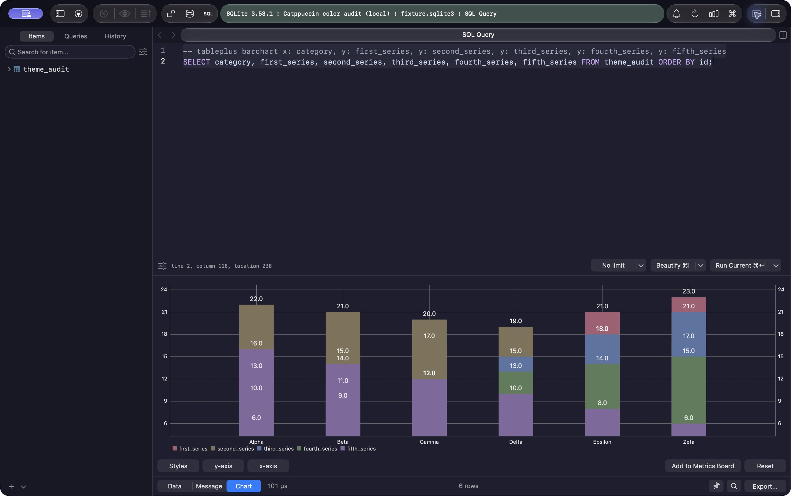
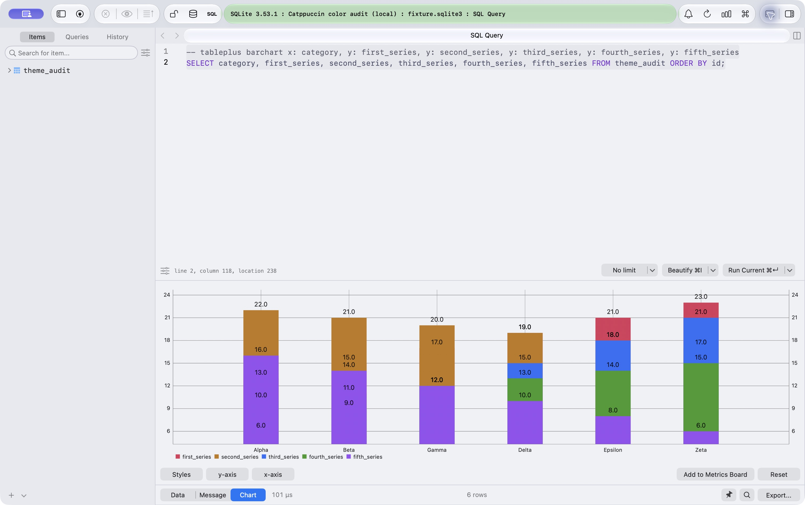
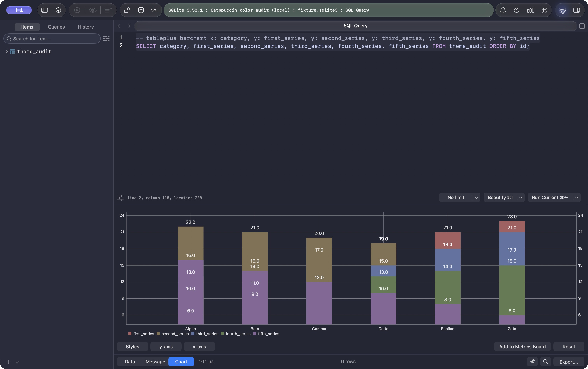
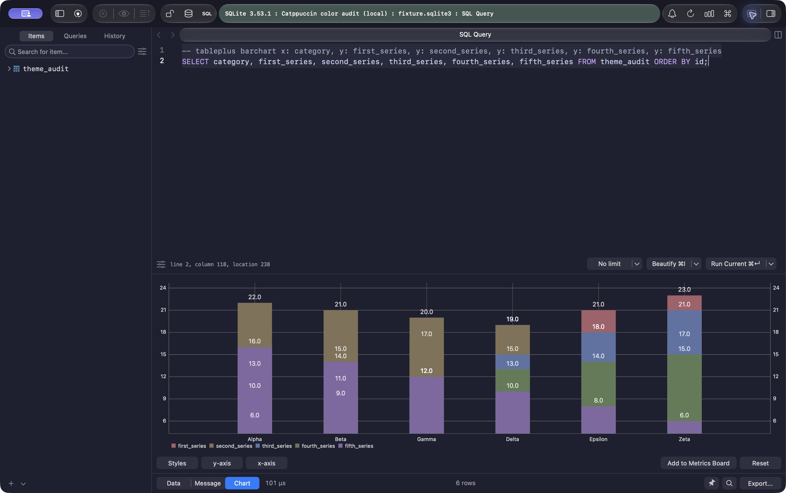

<h3 align="center">
	 
	
	Catppuccin for <a href="https://tableplus.com/">TablePlus</a>
	
</h3>

	
	
	

## About

These themes use the JSON format introduced in TablePlus 26.10.20.

  

## Previews

🌻 Latte

🪴 Frappé

🌺 Macchiato

🌿 Mocha

## Usage

1. Download a flavor below.
2. Open **Fonts & Themes** in TablePlus settings, then choose
   **Add theme… → File or folder…** and select the JSON file.
3. Select the theme under **Custom**.

To update a theme, remove its existing Custom entry before importing it again.

| Flavor | Theme |
| --- | --- |
| Latte | [catppuccin-latte.json](themes/catppuccin-latte.json) |
| Frappé | [catppuccin-frappe.json](themes/catppuccin-frappe.json) |
| Macchiato | [catppuccin-macchiato.json](themes/catppuccin-macchiato.json) |
| Mocha | [catppuccin-mocha.json](themes/catppuccin-mocha.json) |

## 💝 Thanks to

- [Vincent Guillet](https://github.com/vincentguillet) for the original TablePlus port
- [doorcs](https://github.com/doorcs) for porting to the JSON theme format introduced in TablePlus 26.10.20 and improving readability

&nbsp;

	

	Copyright &copy; 2021-present <a href="https://github.com/catppuccin" target="_blank">Catppuccin Org</a>

	

